

  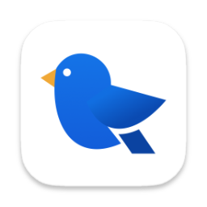
  <h1>Perch</h1>
  
<b>Clipboard · Snippets · Mouse · Keys — the power-user tools macOS forgot, in one menu-bar app.</b>

  Native macOS · SwiftUI · runs quietly in your menu bar · everything stays on your Mac

 

  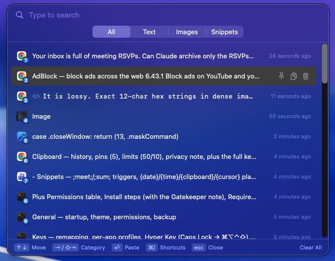
   
  The <code>⇧⌘V</code> clipboard — searchable, categorized, fully keyboard-driven.

---

## Why Perch?

macOS is great, but power users end up installing four separate apps: a clipboard manager, a snippet expander, a mouse remapper, and a keyboard tool. Perch is all four — designed to feel like one app, live in your menu bar, and respect your privacy. No accounts, no cloud, no telemetry. Passwords and sensitive copies are never recorded, and everything stays on your Mac.

- **One app, four tools** — Clipboard, Snippets, Mouse, Keys.
- **Menu-bar first** — a Dock icon is optional; it stays out of your way.
- **Per-app aware** — Mouse and Keys can behave differently in each app.
- **Keyboard-driven** — `⇧⌘V` and a private Hyper Key layer put everything a keystroke away.

---

## 📋 Clipboard

A full clipboard history you open with **`⇧⌘V`** (a floating, non-activating popup) or peek at from the menu bar.

- **History** of text, images, and files, with de-duplication and a configurable cap (default **50** in the popup, **10** in the menu peek).
- **Categories** — filter by All / Text / Images / Snippets right in the popup.
- **Pins** — keep up to **5** items at the top permanently.
- **Search-as-you-type**, per-item actions (pin, copy, delete), and timestamps.
- **Privacy** — passwords and sensitive copies are never recorded; per-app exclusions supported.
- **Appearance** — adjustable row density for how roomy each item looks.

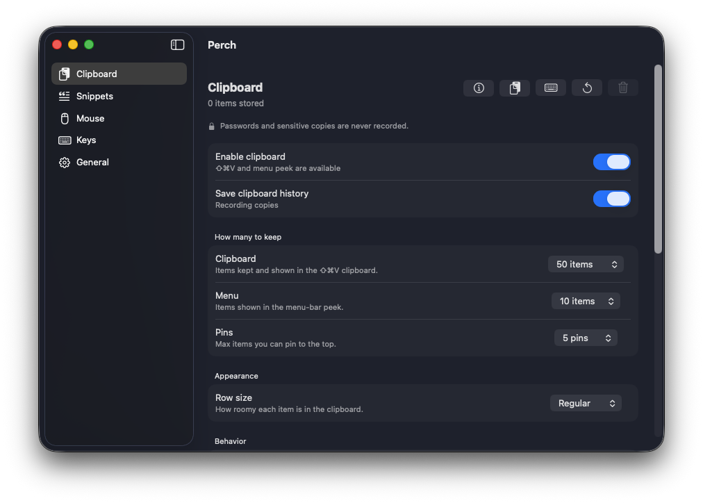

<b>⌨️ Full keyboard shortcuts</b> (press <code>⌘/</code> in the popup for this cheat-sheet)

 

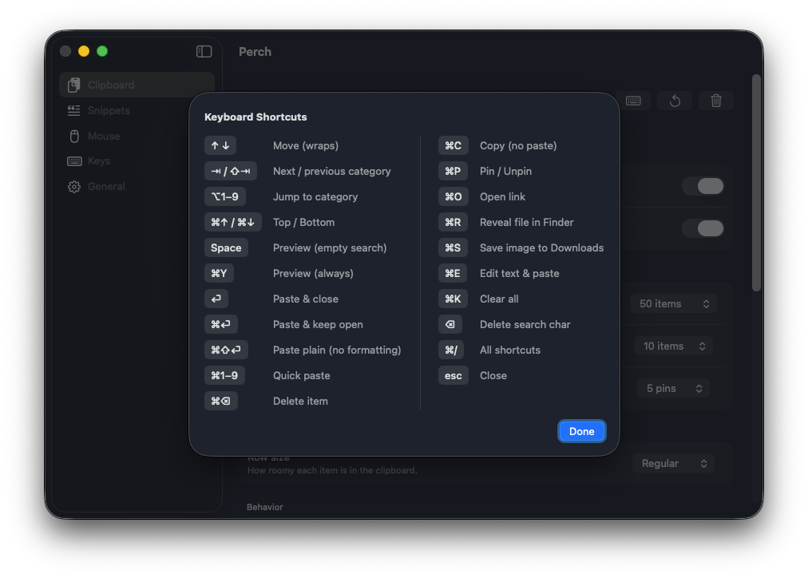

| Key | Action | Key | Action |
|-----|--------|-----|--------|
| `↑ ↓` | Move (wraps) | `⌘C` | Copy (no paste) |
| `→ / ⇧→` | Next / previous category | `⌘P` | Pin / Unpin |
| `⌥1–9` | Jump to category | `⌘O` | Open link |
| `⌘↑ / ⌘↓` | Top / Bottom | `⌘R` | Reveal file in Finder |
| `Space` | Preview (empty search) | `⌘S` | Save image to Downloads |
| `⌘Y` | Preview (always) | `⌘E` | Edit text & paste |
| `↵` | Paste & close | `⌘K` | Clear all |
| `⌘↵` | Paste & keep open | `⌫` | Delete search char |
| `⌘⇧↵` | Paste plain (no formatting) | `⌘/` | All shortcuts |
| `⌘1–9` | Quick paste | `esc` | Close |
| `⌘⌫` | Delete item | | |

---

## ✂️ Snippets

Saved clips you reuse — always in the clipboard, and expandable by typing a trigger **anywhere**.

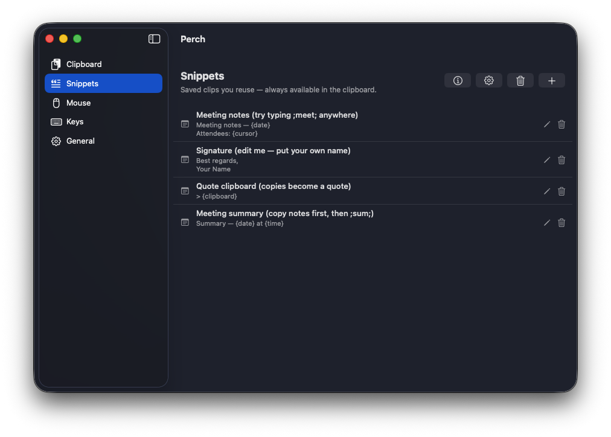

- **Type-to-expand** — type `;meet;` (or `:abbr:`, `//abbr`) and it's instantly replaced by the snippet. The *closing* prefix triggers it, so `;a;` and `;ab;` happily coexist.
- **Dynamic placeholders**, resolved as you paste:
  - `{date}` (with a format picker) · `{time}` · `{clipboard}` (your last copy) · `{cursor}` (where the caret lands afterward).
- **Starter snippets** included (Meeting notes, Signature, Quote clipboard, Meeting summary) to teach by example — all editable, never re-seeded after you clear them.
- Snippets are also a category inside the `⇧⌘V` popup.

---

## 🖱️ Mouse

Turn any mouse into a productivity device — per app or for all apps.

### Buttons & gestures

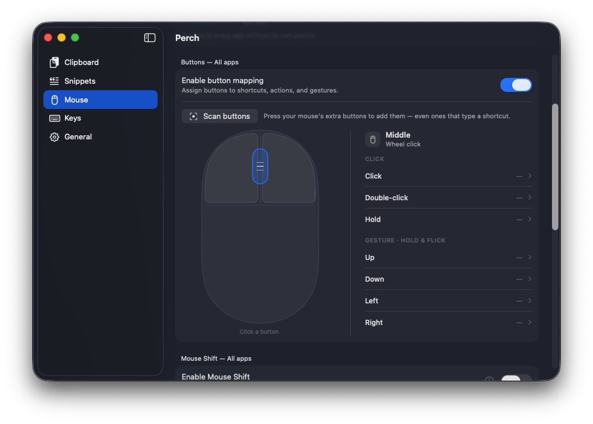

- **Scan buttons** to detect every button your mouse has (even extras).
- Assign **Click / Double-click / Hold** per button → a shortcut, an action, or a typed keystroke.
- **Gestures** — hold & flick **Up / Down / Left / Right** for four more actions per button.

### Mouse Shift (a "G-Shift" layer)

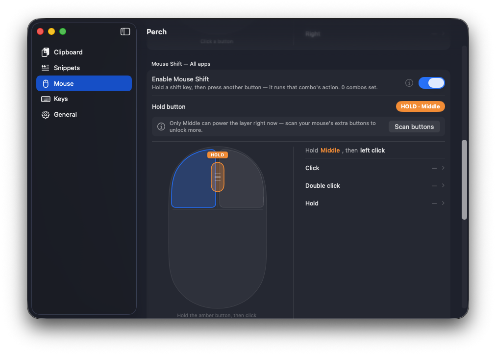

Hold a chosen button (e.g. Middle), then press another button to fire that combo's action — a whole second layer for every button. Each hold key keeps its own independent set of combos.

### Scroll & pointer

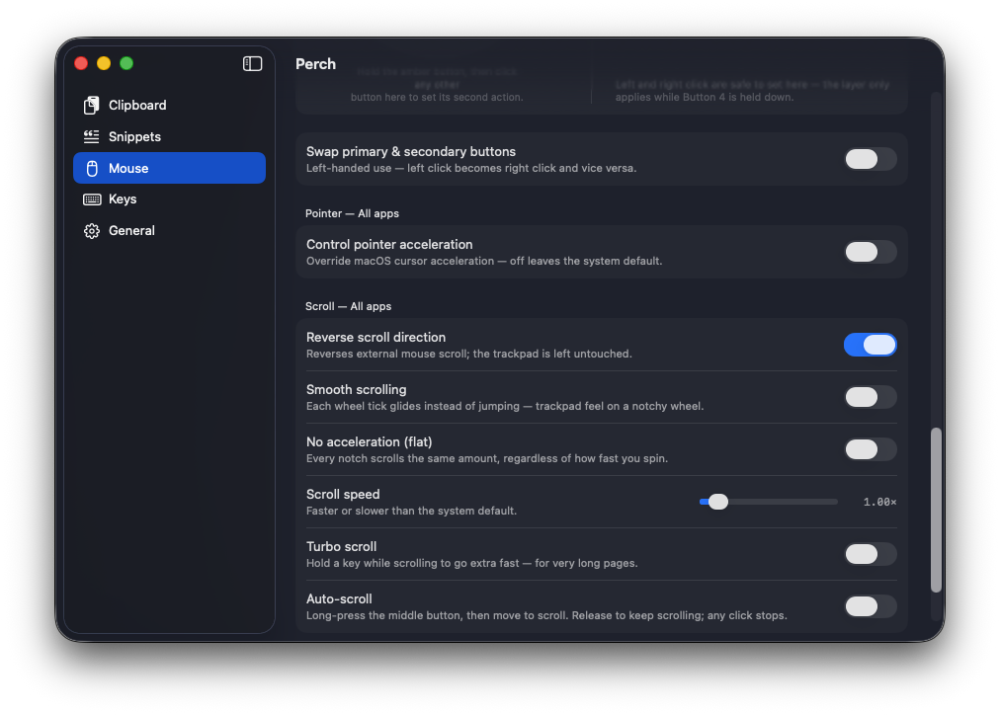

- **Swap primary & secondary buttons** (left-handed mode).
- **Pointer acceleration** override (leaves trackpad untouched).
- **Scroll**: Reverse direction (mouse only), Smooth scrolling (glide on a notchy wheel), No acceleration (flat), Scroll speed, Turbo scroll (hold a key to fly), and Auto-scroll (long-press middle, move to scroll).

---

## ⌨️ Keys

Remap keys and shortcuts **app by app**, with a private shortcut layer.

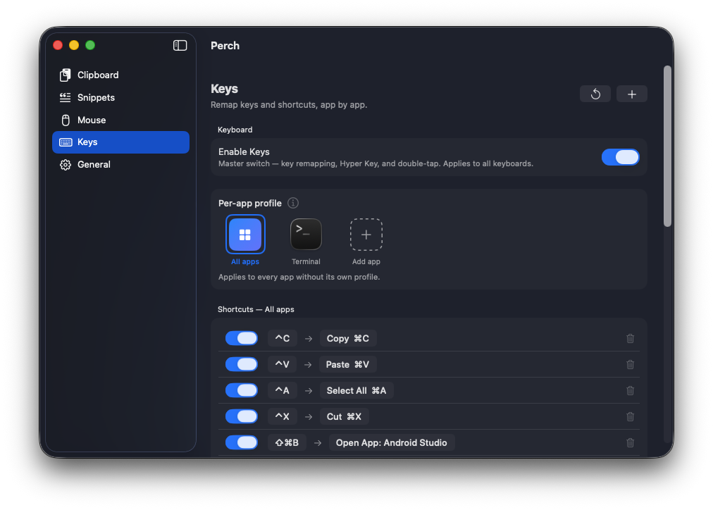

- **Key & shortcut remapping** — e.g. `⌃C → ⌘C`, `⌃V → ⌘V` (Windows muscle memory), or map a combo to **Open App** (e.g. `⇧⌘B → Android Studio`).
- **Per-app profiles** — "All apps" by default, plus custom profiles (e.g. Terminal) that override it.

### Hyper Key & double-tap

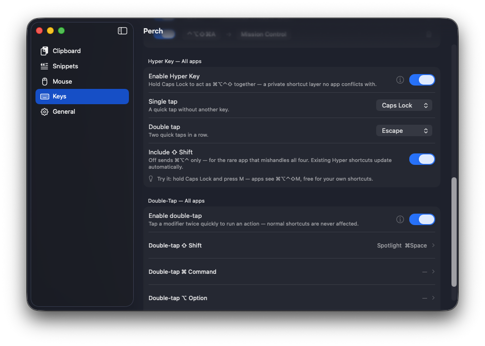

- **Hyper Key** — hold **Caps Lock** to act as `⌘⌥⌃⇧` together: a private shortcut layer no app conflicts with. Single-tap and double-tap get their own actions (e.g. tap → Caps Lock, double-tap → Escape). In apps with a profile that turns it off, Caps Lock stays a real Caps Lock.
- **Double-tap modifiers** — tap a modifier twice quickly to run an action (e.g. double-tap `⇧` → Spotlight) — normal shortcuts are never affected.

---

## ⚙️ General

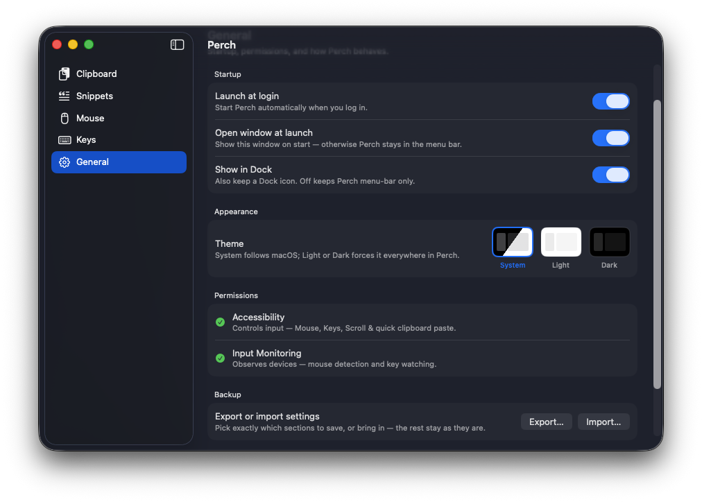

- **Startup** — Launch at login · Open window at launch · Show in Dock (off = menu-bar only).
- **Appearance** — Theme: System / Light / Dark, applied everywhere in Perch.
- **Permissions** — live status for Accessibility and Input Monitoring.
- **Backup** — Export or import settings, choosing exactly which sections to include.

---

## Permissions

Perch needs two macOS permissions and asks only when a feature requires them:

| Permission | Why | Without it |
|-----------|-----|-----------|
| **Accessibility** | Controls input | Mouse, Keys, Scroll & quick clipboard paste stop |
| **Input Monitoring** | Observes devices | Mouse detection & key watching stop |

Grant both in **System Settings → Privacy & Security**, then relaunch Perch.

---

## Installation

1. Download **`Perch-1.0.0.dmg`**.
2. Open it and drag **Perch** onto **Applications**.
3. Launch Perch from Applications.
4. Grant **Accessibility** and **Input Monitoring** when prompted, then relaunch.

> **First-launch note:** Perch isn't notarized for public distribution yet, so macOS may warn about an "unidentified developer." Right-click the app → **Open** → **Open** once; macOS remembers after that.

---

## Requirements

- macOS 14 (Sonoma) or later
- Apple Silicon or Intel

## Privacy

Everything stays on your Mac. Clipboard history is stored locally, passwords and sensitive copies are never recorded, and nothing is sent anywhere.

 <b>Perch</b> · v1.0.0 · made for macOS

